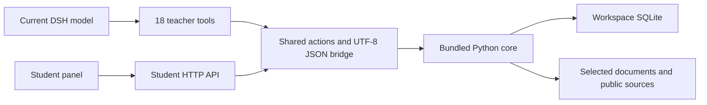

# Architecture / 架构

TutorLoop 将教学决策留在当前 DSH 会话，将学习证据保存在工作区。本说明描述本项目实现，不代表 ChatGPT 内部 Study Mode 架构或同等教学质量。0.4.0 的本地安装与真实宿主验收状态单独记录在 [VALIDATION.md](./VALIDATION.md)。

## 宿主与模型

`src/index.js` 注册 18 个教师工具和动态系统提示，推理由 DSH 完成。普通 bridge 动作不额外请求模型；面板复制绑定 exercise/attempt 的批改请求并回到聊天。`tutor.llm` 的独立客户端只在调用方明确使用时请求模型。用户选用的材料、作答与工具返回可能进入 DSH 模型上下文；本地保存不等于数据永不离机。

`src/client/index.jsx` 注册原生 conversation.view，构建产物 `lib/client.js` 使用宿主模块加载器和 React；改源码后仍须构建。界面默认中文，支持 English/跟随 DSH，不自动翻译材料原文。

## 权限与协议

`src/actions.js` 共享 Node bridge 与学生 HTTP 动作词汇。七个 zhenti 动作走 HTTP→Node→Python 链路；create_practice、get_context、prepare_rubric、apply_feedback、find_materials 仅供教师工具调用。全文检索可包含教师材料，因此不能从学生 API 调用；list_sources 仅返回摘要。

HTTP 检查 Origin、Sec-Fetch-Site、JSON 类型、大小与已确认工作区。本地 CLI 可无 Origin；这不是独立远程用户鉴权。子进程使用参数数组、shell:false、UTF-8、取消、输出上限及超时。取消可能晚于事务提交，重试前先读状态；只有指定提交协议提供幂等保证，不承诺所有写入幂等。

## 题面、量表与图像

新题 `student_material_ids` 明确声明学生材料。任何角色字段被标为教师解析/参考/答案时都不能公开。`public_exercise` 删除 reference_answer、reference_blocks、正确选项、explanation、rubric、hint，仅返回指定学生来源。旧快照无明确声明时隐藏 sources，保留旧 question.material；不据此证明旧题完整。用户仍可自行读取已拥有的原始资料。

已标定量表在作答前冻结。`rubric_status=uncalibrated` 仅定性反馈：awarded、max_points、score、max_score 为 null，不计数值正确率、不推进掌握。prepare_rubric 只在尚无任何作答时确认题目特定分项与依据，已有答案后拒绝变更。新反馈须引用有效 evidence_ids 与学生原句 student_span。

图文采用 stem_blocks、material_blocks、options.blocks、教师 reference_blocks，不执行原始 HTML。仅认可 fb.fbstatic.cn、fb.fenbike.cn 的 HTTPS 图源；协议相对 URL 经校验转 HTTPS。必要图像缺失、截断、不支持或加载失败，不能静默当完整题评分。界面观察加载成功并由用户确认后传 visual_confirmed=true，教师不能代用户确认。

characters 统计非空白字符（含标点）；words 按 Unicode 词项及连字符/撇号连接规则计数。两者均为教学规则，不是官方阅卷扣分口径。

## 工作区、信任与迁移

工具读取 exec.agent.session.header.cwd，UI 使用所选会话 cwd。workspacePath 是显式预信任/回退，否则回退进程 cwd。默认库为 `<workspace>/.dsh-tutorloop/tutor.sqlite3`；显式 dbPath 主动选择共享记录。真题库仍跟随明确工作区，不能从自定义库位置误推断。

旧 `~/.dsh-tutorloop/trusted-workspaces.json` 只读兼容；新授权为 `trusted-workspaces.json.d/<normalized-path-sha256>.json`，每工作区独立临时文件与原子替换，避免多实例覆盖，无全局锁等待。兼容 BOM，规范化 Windows 大小写、分隔符与扩展路径；忽略损坏/hash不符条目、目录符号链接。持久化失败时只保留本会话内存授权。

全部撤销须删除旧 JSON 与 .json.d 目录、移除显式 workspacePath（如有），再重启所有相关宿主。运行进程不实时同步外部撤销；自定义 trustStore 对应自己的文件和 .d 目录。授权撤销不删除学习库，也不提供共享远程宿主的多租户隔离。

历史档案与题目快照保留，不重写历史成绩。整卷 schema 绑定本轮 quiz_id、seed、exercise_ids，报告只读这些实例。练习创建、current 指针与整卷激活/推进同一事务提交，失败回滚。旧 settings 无可靠实例归属时要求重开，不猜测旧成绩归属。

## 检索、导入与导出

导入保留原文、hash、页码与提取限制；NFKC 等检索规范化不改引用原文。PDF 提取不自动形成完整可评分试卷。联网来源区分摘要与全文；获取器限制体积、校验公网目标与跳转，资料指令不能覆盖教学策略。

大库采用候选筛选后 BM25，已修复规范化、阈值切换与词项召回问题；候选集统计和截断仍可能改变排序，不保证全库 BM25 等价。真题是用户本地资料，不随 npm 分发，不把单个工作区题量当成公共能力。

Memoir 仅生成待审阅摘要。内部 StudyHub 转换器输出草稿与来源 sidecar，不自动写外部库；当前不支持图文而拒绝视觉题，未标定开放题不能导出评分量表。保留字/词计量，课程与主题从显式档案、科目或中性默认推断。

当前边界包括模型依赖的主观教学质量、有限示例、启发式复习安排及文档提取限制。程序无法阻止模型披露已收到的教师信息；TutorLoop 不是监考平台。
