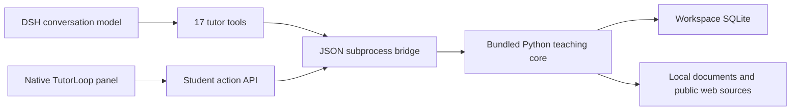

# Architecture

TutorLoop keeps teaching decisions in the DSH conversation and learning evidence in a local store. Its architecture describes this implementation, not ChatGPT's internal Study Mode.

`src/index.js` registers host tools and a dynamic system-prompt section. The model uses existing DSH inference; plugin tools do not make additional model calls. `src/client/index.jsx` registers a native `conversation.view`. The build produces DSH's module-loader factory at `lib/client.js`, sharing the host's React runtime.

The HTTP route accepts only student actions. Teacher context, task creation and feedback persistence stay tool-only. Reference answers and rubrics are frozen before a learner submits. The backend validates source IDs, grading criteria, maximum points and evidence spans before saving feedback. It distinguishes independent, assisted and revised attempts and schedules later checks. A stale version or duplicate submission cannot silently become a different answer.

Each tool request resolves `exec.agent.session.header.cwd` and an external SQLite path. `workspacePath` supplies an explicit fallback; otherwise process cwd is used. The UI obtains cwd from the host's selected session and the server checks it against known host workspaces. This prevents arbitrary browser paths from being accepted; it does not create tenant isolation for a shared remote host. An explicit `dbPath` intentionally opts into one shared store.

The Python child uses argument arrays, `shell:false`, UTF-8 stdin/stdout, cancellation, bounded output and timeouts. Reads and writes happen in SQLite transactions, but cancellation can occur after a committed operation: reread state before retrying. The npm package is immutable program code; the interpreter environment and learning data live outside it.

Local imports retain source text, hashes, page numbers and extraction limitations. Search results distinguish full visible text from provider snippets. The URL fetcher limits response size, checks public destinations and validates redirects. Retrieved documents are evidence, not instructions that may replace the teaching policy.

Memoir receives no automatic writes. A candidate summary is offered for review; raw answers remain in the learning database. The internal StudyHub exporter produces a deck plus provenance sidecar, but automatic runtime integration with StudyHub is outside this release.

Current limitations include text-only PDF extraction, a small Chinese example curriculum, heuristic review intervals, and model-dependent subjective feedback. Browser and bridge restrictions cannot prevent a teacher model from revealing information it has already received. TutorLoop is a learning tool, not a secure examination platform.
